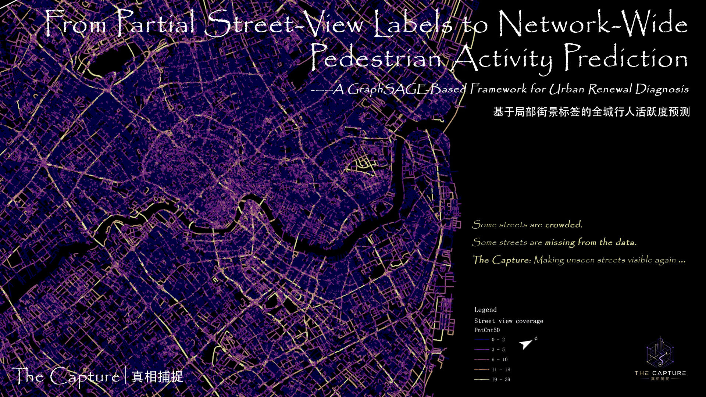
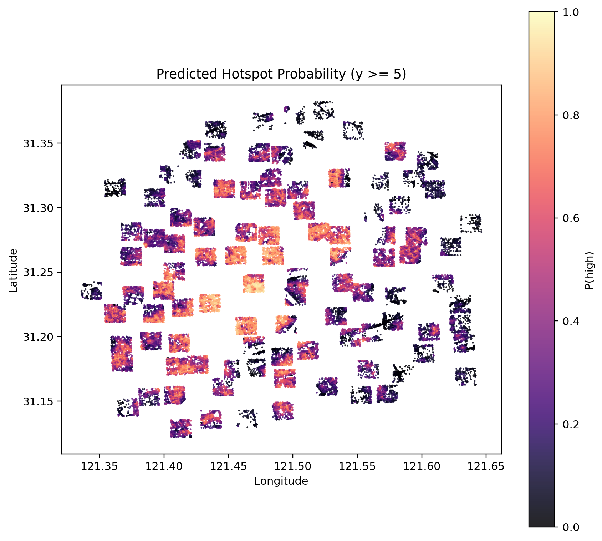
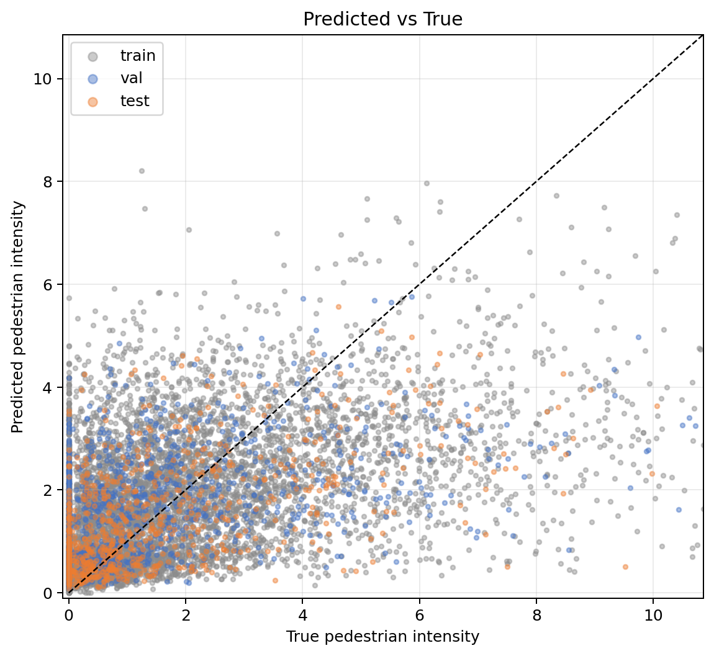
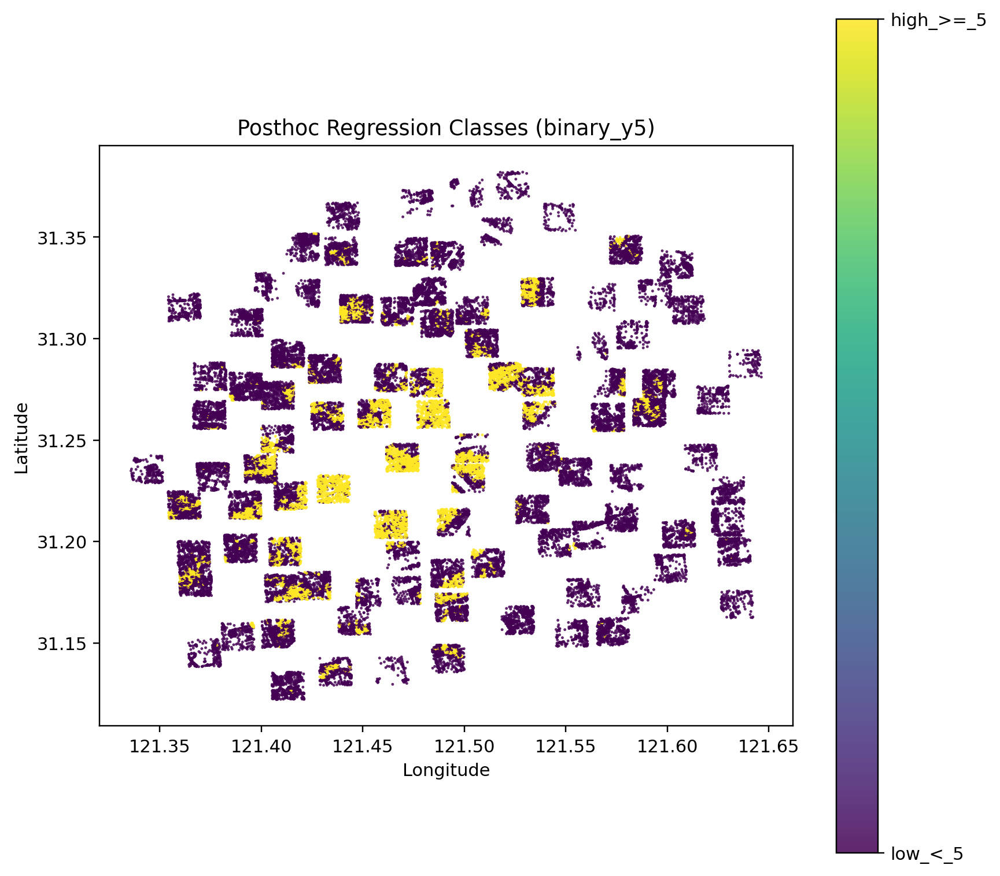
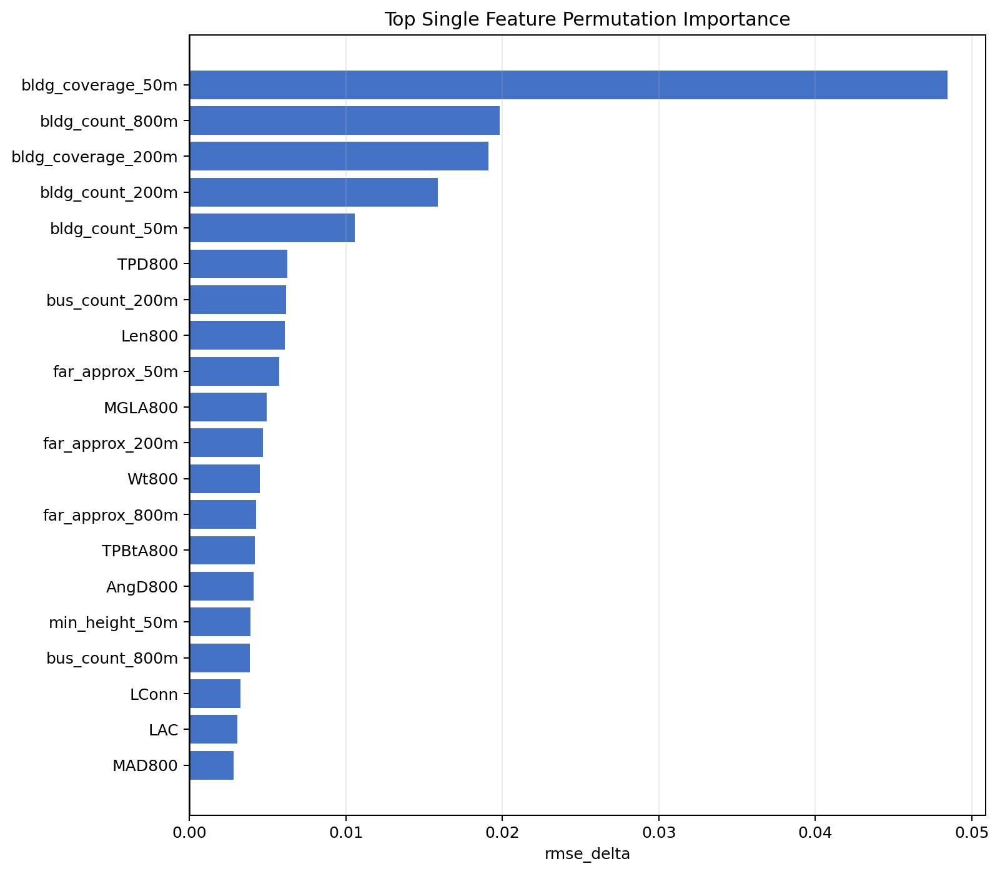

# From Partial Street-View Labels to Network-Wide Pedestrian Activity Prediction

**A GraphSAGE-Based Framework for Urban Renewal Diagnosis**
*DigitalFUTURES Workshop project · Team **The Capture** (7 members) · Shanghai, 100 graph tiles*



> If we only observe part of a city through street-view imagery, can we still infer how pedestrian
> activity is distributed across the **entire** urban network? This project answers with an
> inductive **GraphSAGE** framework: street-view imagery (SVI) supervises, the built environment
> predicts — so streets *without* any imagery (residential lanes, back streets, alleys) become
> genuinely inferable.

---

## Highlights

- **Inductive graph learning** — training and test graphs are topologically independent; the model learns a transferable neighborhood-aggregation function rather than memorizing one city district.
- **SVI as labels only, never as input** — panoramas are processed from four orthogonal views with YOLO11 pedestrian detection plus a VLM quality audit, then aggregated to road-segment labels. Because imagery never enters the feature space, the model extends to unobserved streets.
- **Zero manual semantic annotation** — no road-class tagging, no gate labeling, no super-nodes; all 60 node features come from automated geometric computation.
- **Spatial tiling** — Shanghai within the Outer Ring Road is split into 100 tiles of 1.5 km × 1.5 km cores with 800 m buffers ("ghost nodes" join message passing but not the loss).

## Results

| Metric | Value |
| --- | --- |
| Test-set Pearson correlation (regression) | **0.554** |
| High-vitality recall (binary screening, threshold 1.12) | **74.5%** |
| External validation | Predicted hotspots align strongly with POI evidence of commerce, transit and public services |

| Predicted hotspot probability (y ≥ 5) | Regression: predicted vs. true |
| :---: | :---: |
|  |  |

| Discretized spatial classes | Top-20 feature importance |
| :---: | :---: |
|  |  |

Errors are not random: they concentrate around transport hubs and large commercial complexes —
places driven by functional and temporal dynamics beyond the current feature set. We therefore
also provide a **planning diagnosis framework**: combining predicted vs. observed values flags
*renewal-priority* streets whose predicted vitality far exceeds what is observed.

## Presentation

- 🎤 Full talk script (≈12 min): [docs/presentation/SCRIPT.md](docs/presentation/SCRIPT.md)
- 🖼 All 23 slides: [docs/presentation/slides/](docs/presentation/slides/)

## Pipeline

```
Stage 1 — Label production (SVI → segment-level supervision)
  Street-view panoramas (4 orthogonal views)
    → YOLO11 person counting            app/batch_detect.py
    → YOLO11 pose estimation            app/batch_pose.py
    → merge detection + pose            app/merge_detect_pose.py
    → auto QC routing                   scripts/qc/auto_qc_router.py
    → VLM audit (SiliconFlow)           scripts/qc/vlm_audit_images_siliconflow.py
    → final image-level labels          scripts/qc/resolve_final_counts.py
    → snap & aggregate to segments      scripts/qc/aggregate_final_to_segment_labels.py

Stage 2 — Graph learning (built environment → pedestrian activity)
  Road network split into segment nodes + intersection edges
    → 60-dim features: geometry(3) + buildings@3 buffers(27) + transit(6) + population(6) + sDNA topology(18)
    → GraphSAGE regression              scripts/gnn/train_graphsage_npz.py
    → GraphSAGE hotspot classifier      scripts/gnn/train_graphsage_classifier_npz.py
    → 5-fold graph-level CV / sweeps    scripts/gnn/run_graphsage_cv_sweep.py
    → feature importance, post-hoc discretization, visualization
```

## Repository structure

```
├── app/                    # YOLO11 batch detection, pose estimation, merging
├── scripts/
│   ├── gnn/                # GraphSAGE training, CV sweeps, importance, post-processing
│   ├── qc/                 # QC routing, VLM audit, label resolution & aggregation
│   └── ...                 # manifest building, delta batches, orchestration
├── viz_portable/           # offline interactive 2D/3D result explorer (double-click index.html)
├── docs/
│   ├── WORKFLOW.md         # full command-line workflow (all training configs)
│   ├── technical_outline_zh.md   # full technical outline (Chinese)
│   ├── presentation/       # talk script + 23 slides
│   └── figures/            # result figures
└── requirements.txt
```

> **Note** — `data/` (~49 GB street-view tiles), `dataset/` (prebuilt graph samples), `outputs/`
> (training runs) and YOLO weights (`*.pt`) are too large to distribute with the repo.
> Reproduction steps live in [docs/WORKFLOW.md](docs/WORKFLOW.md).

## Quick start

```bash
pip install -r requirements.txt
# GNN training additionally needs PyTorch Geometric (match your CUDA version)
pip install torch_geometric
```

Minimal example — train the GraphSAGE regressor:

```bash
python scripts/gnn/train_graphsage_npz.py \
  --dataset-root dataset/SHdataset \
  --tile-start 1 --tile-end 100 \
  --hidden-dim 64 --num-layers 2 --dropout 0.15 \
  --loss huber \
  --feature-transform skew_log1p_clip --feature-clip-quantile 0.999 \
  --target-transform log1p_zscore \
  --device cuda
```

The VLM audit step requires the `SILICONFLOW_API_KEY` environment variable (no keys are stored in this repo). Full commands, including the current best hyper-parameter configurations, are in [docs/WORKFLOW.md](docs/WORKFLOW.md); the 100-tile data onboarding guide is in [README_100tile_yolo_vlm_pipeline.md](README_100tile_yolo_vlm_pipeline.md).

## Interactive visualization

`viz_portable/` is a zero-dependency offline web app: double-click `index.html` to explore 2D
top-down prediction maps and an immersive 3D view — with prediction / ground-truth / residual /
hotspot layers, tile & split filters, node hover details, per-variable influence panels, and PNG
export. No Python, Node or model dependencies required.

## Planning applications

1. **Ex-ante evaluation** — predict pedestrian corridors and cold spots for planned districts from building programs, road networks and station siting alone, before anything is built.
2. **Scheme comparison** — quantify the "function–form–footfall" coupling to support walkability-first design decisions.
3. **Renewal screening** — streets where the model says "this should be busy" but observation says otherwise are exactly the ones worth field investigation.
4. **Low-data city transfer** — freeze the feature extractor, fine-tune the regression head with a handful of local labels.

## Team

**The Capture (真相捕捉)** — Ruixiao Zhang, Jiarui Yang, Weixi Feng, Peizheng Hao, Shuzhen Chen, Yuhan Yang, Hengyuan Rao.

---

*Research demo — code and documentation are being organized continuously. Issues and discussions welcome.*
