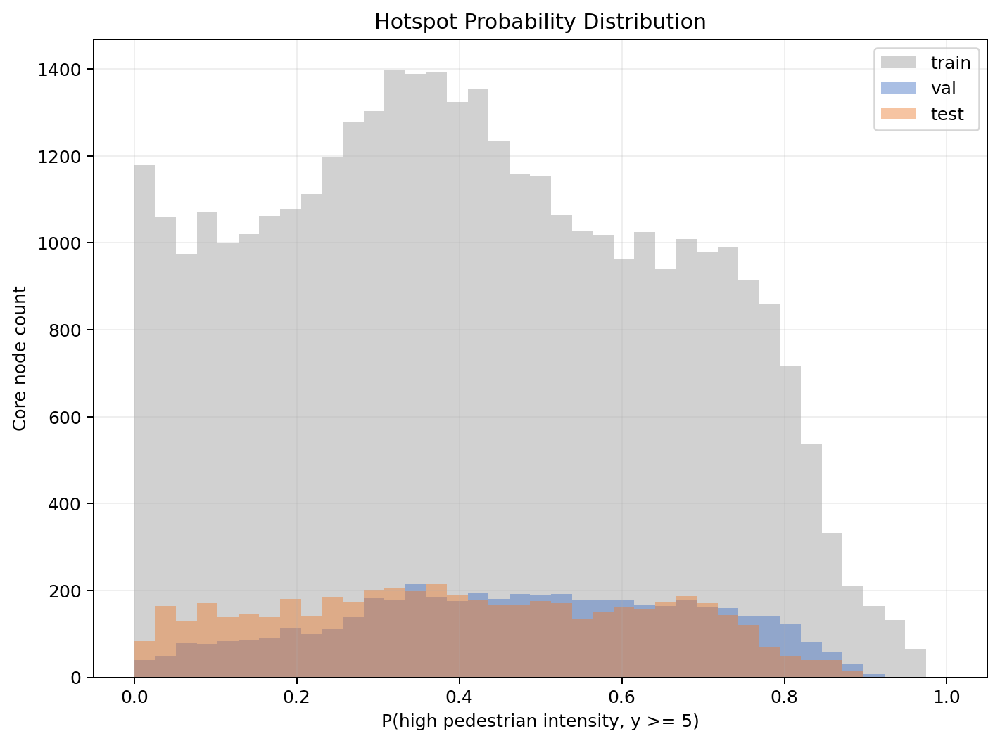
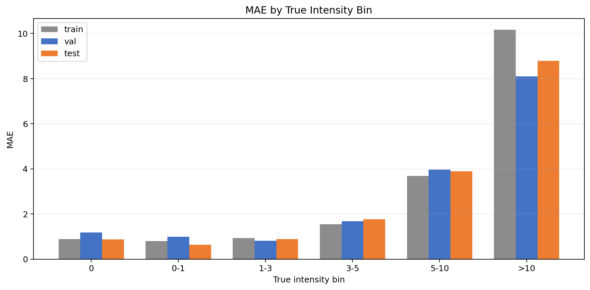
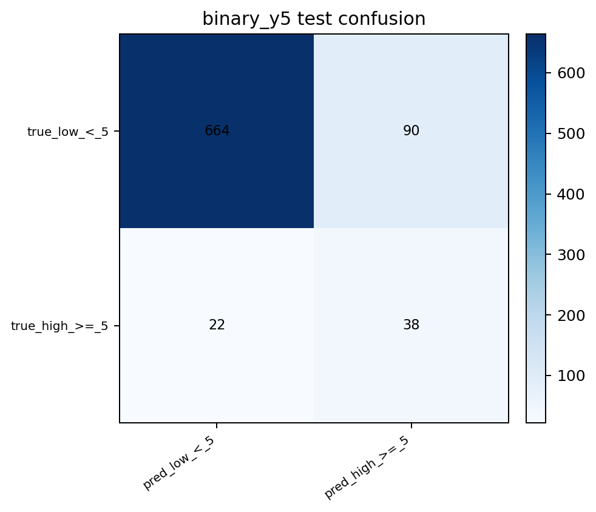
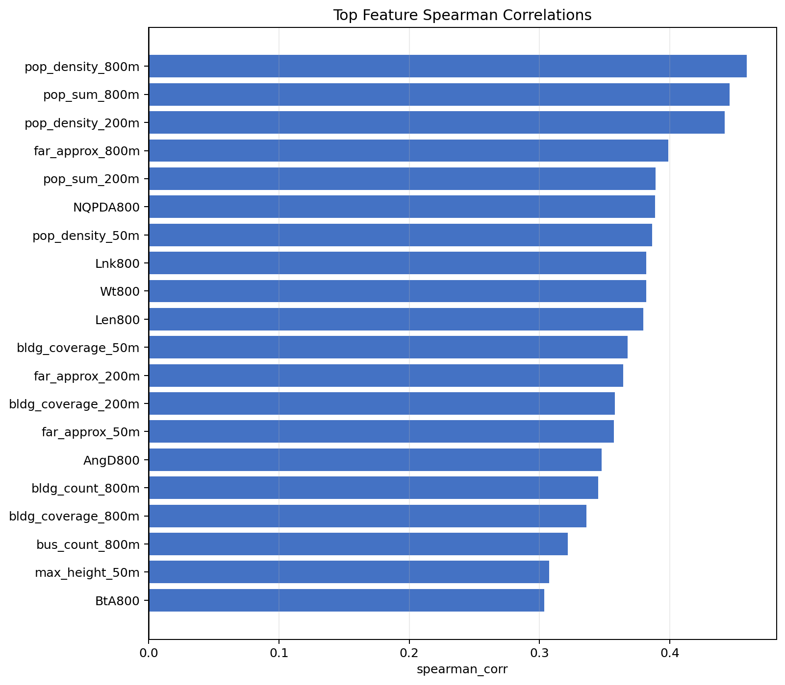

[English](README.md) | [简体中文](README.zh-CN.md)

<a id="from-partial-street-view-labels-to-network-wide-pedestrian-activity-prediction--从局部街景标签到全路网行人活动预测"></a>
<a id="from-partial-street-view-labels-to-network-wide-pedestrian-activity-prediction"></a>
<a id="从局部街景标签到全路网行人活动预测"></a>

# From Partial Street-View Labels to Network-Wide Pedestrian Activity Prediction

**A GraphSAGE-Based Framework for Urban Renewal Diagnosis**
*DigitalFUTURES Workshop project · Team **The Capture** (7 members) · Shanghai, 100 graph tiles*

[](https://youtu.be/BVTGtNkeBZ8)
[](https://shawn200212.github.io/DigitalFutures-Workshop-Pedestrian-Activity-Prediction/viz_portable/)
[](https://ruixiaozhang.com)

[](https://youtu.be/BVTGtNkeBZ8)

> If we only observe part of a city through street-view imagery, can we still infer how pedestrian
> activity is distributed across the **entire** urban network? This project answers with an
> inductive **GraphSAGE** framework: street-view imagery (SVI) supervises, the built environment
> predicts — so streets *without* any imagery (residential lanes, back streets, alleys) become
> genuinely inferable.

**Quick links** — 🎬 [Project video on YouTube](https://youtu.be/BVTGtNkeBZ8) · ⬡ [Interactive 2D/3D explorer](https://shawn200212.github.io/DigitalFutures-Workshop-Pedestrian-Activity-Prediction/viz_portable/) · 📄 [Talk script](docs/presentation/SCRIPT.md) · 🎨 [More of my work — ruixiaozhang.com](https://ruixiaozhang.com)

---

<a id="highlights--核心特点"></a>
<a id="highlights"></a>
<a id="核心特点"></a>

## Highlights

- **Inductive graph learning** — training and test graphs are topologically independent; the model learns a transferable neighborhood-aggregation function rather than memorizing one city district.
- **SVI as labels only, never as input** — panoramas are processed from four orthogonal views with YOLO11 pedestrian detection plus a VLM quality audit, then aggregated to road-segment labels. Because imagery never enters the feature space, the model extends to unobserved streets.
- **Zero manual semantic annotation** — no road-class tagging, no gate labeling, no super-nodes; all 60 node features come from automated geometric computation.
- **Spatial tiling** — Shanghai within the Outer Ring Road is split into 100 tiles of 1.5 km × 1.5 km cores with 800 m buffers ("ghost nodes" join message passing but not the loss).

<a id="results--结果"></a>
<a id="results"></a>
<a id="结果"></a>

## Results

| Metric | Value |
| --- | --- |
| Test-set Pearson correlation (regression) | **0.554** |
| High-vitality recall (binary screening, threshold 1.12) | **74.5%** |
| External validation | Predicted hotspots align strongly with POI evidence of commerce, transit and public services |

| Predicted hotspot probability (y ≥ 5) | Regression: predicted vs. true |
| :---: | :---: |
|  |  |

| Discretized spatial classes | Top-20 feature importance |
| :---: | :---: |
|  |  |

Errors are not random: they concentrate around transport hubs and large commercial complexes —
places driven by functional and temporal dynamics beyond the current feature set. We therefore
also provide a **planning diagnosis framework**: combining predicted vs. observed values flags
*renewal-priority* streets whose predicted vitality far exceeds what is observed.

<details>
<summary><b>More figures</b> — training dashboard, CV sweeps, calibration & error analysis (click to expand)</summary>

| Training dashboard | Hotspot score map (calibrated) |
| :---: | :---: |
|  |  |

| 5-fold CV config ranking | Per-fold validation RMSE |
| :---: | :---: |
|  |  |

| Hotspot probability distribution | Error by intensity bin | Confusion (binary y≥5, test) |
| :---: | :---: | :---: |
|  |  |  |

| Feature correlation (top-20) |
| :---: |
|  |

</details>

<a id="presentation--video--演示与视频"></a>
<a id="presentation--video"></a>
<a id="演示与视频"></a>

## Presentation & video

**🎬 [Watch the full project video on YouTube →](https://youtu.be/BVTGtNkeBZ8)**

[](https://youtu.be/BVTGtNkeBZ8)

- 🎤 Full talk script (≈12 min): [docs/presentation/SCRIPT.md](docs/presentation/SCRIPT.md)
- 🖼 All 23 slides: [docs/presentation/slides/](docs/presentation/slides/)

<a id="pipeline--流水线"></a>
<a id="pipeline"></a>
<a id="流水线"></a>

## Pipeline

```
Stage 0 — Image acquisition (sampled road points → street-view imagery)
  100 tiles of WGS-84 sample points        data_acquisition/tiles/*.csv
    → panorama fetch + date selection      data_acquisition/stvscrawler/
    → panorama → 4 × 720×720 views         data_acquisition/flat_images_pano.py
    → batch over all tiles + manifests     data_acquisition/run_all_tiles.py

Stage 1 — Label production (SVI → segment-level supervision)
  Street-view panoramas (4 orthogonal views)
    → YOLO11 person counting            app/batch_detect.py
    → YOLO11 pose estimation            app/batch_pose.py
    → merge detection + pose            app/merge_detect_pose.py
    → auto QC routing                   scripts/qc/auto_qc_router.py
    → VLM audit (SiliconFlow)           scripts/qc/vlm_audit_images_siliconflow.py
    → final image-level labels          scripts/qc/resolve_final_counts.py
    → snap & aggregate to segments      scripts/qc/aggregate_final_to_segment_labels.py

Stage 2 — Graph learning (built environment → pedestrian activity)
  Road network split into segment nodes + intersection edges
    → 60-dim features: geometry(3) + buildings@3 buffers(27) + transit(6) + population(6) + sDNA topology(18)
    → GraphSAGE regression              scripts/gnn/train_graphsage_npz.py
    → GraphSAGE hotspot classifier      scripts/gnn/train_graphsage_classifier_npz.py
    → 5-fold graph-level CV / sweeps    scripts/gnn/run_graphsage_cv_sweep.py
    → feature importance, post-hoc discretization, visualization
```

<a id="repository-structure--仓库结构"></a>
<a id="repository-structure"></a>
<a id="仓库结构"></a>

## Repository structure

```
├── data_acquisition/       # Stage 0 — street-view crawler + 100-tile sampling points (self-contained)
├── app/                    # YOLO11 batch detection, pose estimation, merging
├── scripts/
│   ├── gnn/                # GraphSAGE training, CV sweeps, importance, post-processing
│   ├── qc/                 # QC routing, VLM audit, label resolution & aggregation
│   └── ...                 # manifest building, delta batches, orchestration
├── viz_portable/           # offline interactive 2D/3D result explorer (double-click index.html)
├── docs/
│   ├── WORKFLOW.md         # full command-line workflow (all training configs)
│   ├── technical_outline_zh.md   # full technical outline (Chinese)
│   ├── presentation/       # talk script + 23 slides
│   └── figures/            # result figures
└── requirements.txt
```

> **Note** — `data/` (~49 GB street-view tiles), `dataset/` (prebuilt graph samples), `outputs/`
> (training runs) and YOLO weights (`*.pt`) are too large to distribute with the repo.
> Reproduction steps live in [docs/WORKFLOW.md](docs/WORKFLOW.md). The imagery itself is not
> redistributed, but the **acquisition code and the 100-tile sampling points** are — see
> [data_acquisition/](data_acquisition/), which is kept isolated from the research pipeline
> (its own requirements, no cross-imports, and not needed to run anything else here).

<a id="quick-start--快速开始"></a>
<a id="quick-start"></a>
<a id="快速开始"></a>

## Quick start

```bash
pip install -r requirements.txt
# GNN training additionally needs PyTorch Geometric (match your CUDA version)
pip install torch_geometric
```

Minimal example — train the GraphSAGE regressor:

```bash
python scripts/gnn/train_graphsage_npz.py \
  --dataset-root dataset/SHdataset \
  --tile-start 1 --tile-end 100 \
  --hidden-dim 64 --num-layers 2 --dropout 0.15 \
  --loss huber \
  --feature-transform skew_log1p_clip --feature-clip-quantile 0.999 \
  --target-transform log1p_zscore \
  --device cuda
```

The VLM audit step requires the `SILICONFLOW_API_KEY` environment variable (no keys are stored in this repo). Full commands, including the current best hyper-parameter configurations, are in [docs/WORKFLOW.md](docs/WORKFLOW.md); the 100-tile data onboarding guide is in [README_100tile_yolo_vlm_pipeline.md](README_100tile_yolo_vlm_pipeline.md).

<a id="interactive-visualization--交互式可视化"></a>
<a id="interactive-visualization"></a>
<a id="交互式可视化"></a>

## Interactive visualization

**▶ Live demo: [open the explorer in your browser](https://shawn200212.github.io/DigitalFutures-Workshop-Pedestrian-Activity-Prediction/viz_portable/)** (GitHub Pages)

[](https://shawn200212.github.io/DigitalFutures-Workshop-Pedestrian-Activity-Prediction/viz_portable/)

`viz_portable/` is a zero-dependency web app — the screenshot above is its 2D top-down prediction
map (all 100 tiles, viridis = predicted pedestrian intensity). It also offers an immersive 3D view,
prediction / ground-truth / residual / hotspot layers, tile & split filters, node hover details,
per-variable influence panels, and PNG export. Run it locally by double-clicking
`viz_portable/index.html` — no Python, Node or model dependencies required.

<a id="planning-applications--规划应用"></a>
<a id="planning-applications"></a>
<a id="规划应用"></a>

## Planning applications

1. **Ex-ante evaluation** — predict pedestrian corridors and cold spots for planned districts from building programs, road networks and station siting alone, before anything is built.
2. **Scheme comparison** — quantify the "function–form–footfall" coupling to support walkability-first design decisions.
3. **Renewal screening** — streets where the model says "this should be busy" but observation says otherwise are exactly the ones worth field investigation.
4. **Low-data city transfer** — freeze the feature extractor, fine-tune the regression head with a handful of local labels.

<a id="team--my-role--团队与我的职责"></a>
<a id="team--my-role"></a>
<a id="团队与我的职责"></a>

## Team & my role

This is a **team project** by the 7-member team *The Capture* at the DigitalFUTURES Workshop.
This repository is maintained by **Ruixiao Zhang**; my responsibilities in the project were:

- **GraphSAGE training with AI-assisted programming** — building and iterating the GNN training code (`scripts/gnn/`), loss/feature/target-transform experiments, CV sweeps and early-stopping strategy;
- **Initial model architecture** — the inductive GraphSAGE setup: graph tiling with core/buffer masking, 60-dim feature specification, graph-level splits;
- **Model result visualization** — post-hoc analysis figures and the offline interactive 2D/3D explorer (`viz_portable/`);
- **Network-wide data collection & pre-processing** — crawling multi-source data across the study area and the cleaning/manifest/dedup pipeline that prepares raw inputs before they enter the dataset (`data_acquisition/`, `scripts/prepare_yolo_manifest_from_tiles.py`, `scripts/qc/`). See [data_acquisition/README.md](data_acquisition/README.md) for what in that module is adapted from third-party crawler code and what is the project's own.

Other parts of the project (e.g. parts of label auditing, POI validation and the final deck design) were contributed by teammates and are credited to the team as a whole.

<a id="more-of-my-work--更多作品"></a>
<a id="more-of-my-work"></a>
<a id="更多作品"></a>

## More of my work

🎨 **Portfolio — [ruixiaozhang.com](https://ruixiaozhang.com)** · game design, realtime animation, embodied AI and urban research
🎬 **YouTube — [@ruixiaozhang](https://www.youtube.com/channel/UCyr-ubod7eNa6XhET25vdmw)** · project videos and gameplay demos
💻 **GitHub — [Shawn200212](https://github.com/Shawn200212)**

---

*Research demo — code and documentation are being organized continuously. Issues and discussions welcome.*
