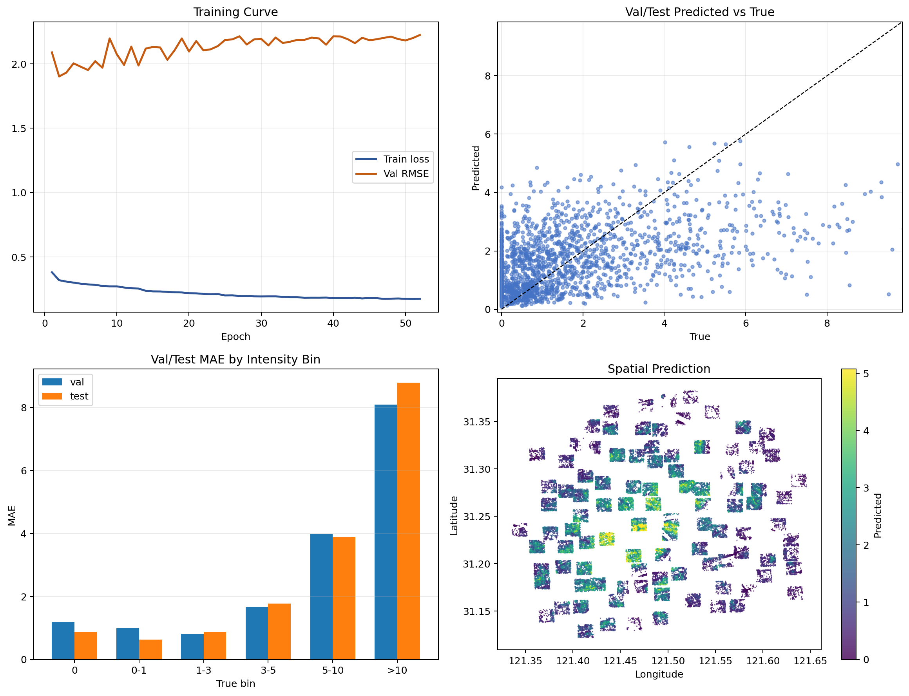
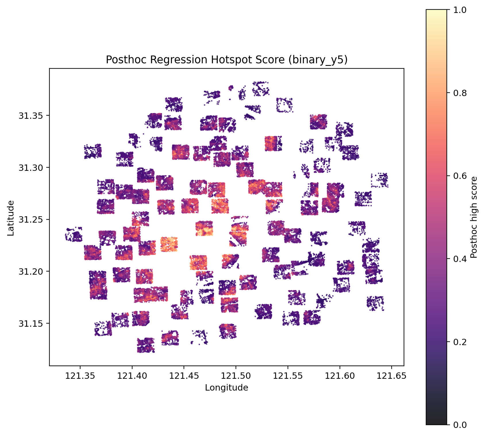
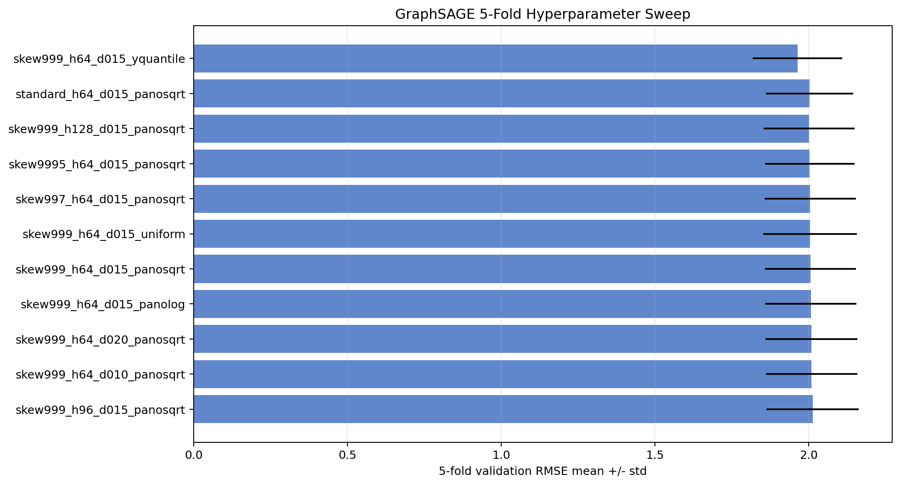
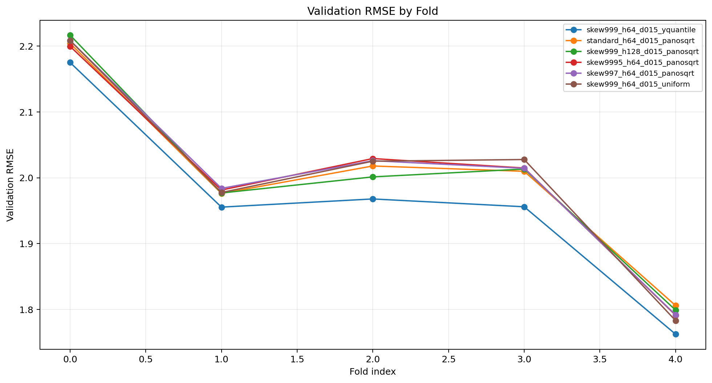
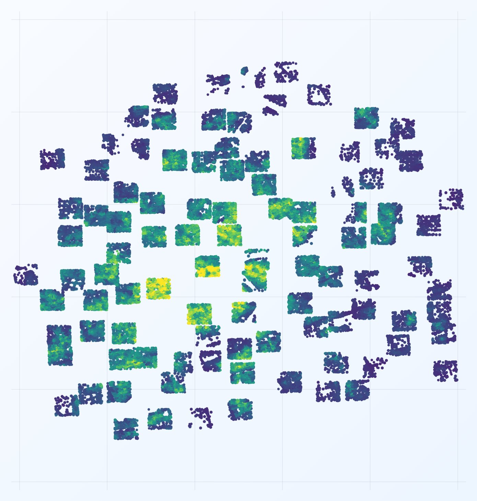

# 从局部街景标签到全路网行人活动预测

[English](README.md) | **中文**

**面向城市更新诊断的 GraphSAGE 框架**
*DigitalFUTURES 工作营项目 · Team **The Capture**（7 人）· 上海，100 个图分块*

[项目视频](https://youtu.be/BVTGtNkeBZ8) ·
[交互式 2D/3D 浏览器](https://shawn200212.github.io/DigitalFutures-Workshop-Pedestrian-Activity-Prediction/viz_portable/) ·
[演讲稿](docs/presentation/SCRIPT.md) ·
[作品集](https://ruixiaozhang.com)

[](https://youtu.be/BVTGtNkeBZ8)

> 如果我们只能通过街景观察城市的一部分，是否仍能推断整个路网中的行人活动分布？
> 本项目使用归纳式 **GraphSAGE** 回答这一问题：街景图像只提供监督标签，建成环境特征负责预测，
> 因而没有街景的居住巷道、背街和小路也可被推断。

## 核心特点

- **归纳式图学习：**训练图与测试图在拓扑上彼此独立；模型学习可迁移的邻域聚合函数，而不是
  记住单个城区。
- **街景只作为标签，不作为输入：**全景图经过四向投影、YOLO11 行人检测与 VLM 质量审核后，
  聚合为路段标签。图像不进入特征空间，因此模型可以扩展到未观测街道。
- **零人工语义标注：**不手工标道路类型、出入口或超级节点；60 维节点特征全部由几何计算生成。
- **空间分块：**上海外环内区域被划分为 100 个 1.5 km × 1.5 km 核心区，并附 800 m 缓冲区；
  “幽灵节点”参与消息传递，但不进入损失。

## 结果

| 指标 | 数值 |
|---|---|
| 测试集 Pearson 相关系数（回归） | **0.554** |
| 高活力召回率（二分类筛查，阈值 1.12） | **74.5%** |
| 外部验证 | 预测热点与商业、交通和公共服务 POI 证据高度一致 |

| 预测热点概率（y ≥ 5） | 回归：预测值与真实值 |
|:---:|:---:|
|  |  |

| 离散空间类别 | 前 20 个重要特征 |
|:---:|:---:|
|  |  |

误差并非随机分布，而集中在交通枢纽和大型商业综合体——这些地点受到当前特征集之外的功能与
时间动态驱动。因此项目还提供规划诊断框架：对照预测值与观测值，识别“按建成环境本应繁忙、
实际却不繁忙”的更新优先街道。

<details>
<summary><b>更多图表</b>——训练仪表盘、交叉验证扫描、校准与误差分析</summary>

| 训练仪表盘 | 校准后的热点分数图 |
|:---:|:---:|
|  |  |

| 五折配置排名 | 各折验证 RMSE |
|:---:|:---:|
|  |  |

</details>

## 演示与视频

**[观看完整项目视频](https://youtu.be/BVTGtNkeBZ8)**

[](https://youtu.be/BVTGtNkeBZ8)

- 完整约 12 分钟演讲稿：[docs/presentation/SCRIPT.md](docs/presentation/SCRIPT.md)
- 23 张幻灯片：[docs/presentation/slides/](docs/presentation/slides/)

## 流水线

```text
阶段 0：图像采集（道路采样点 → 街景图像）
  100 个 WGS-84 分块采样点
    → 全景图抓取与日期选择
    → 全景图转换为 4 × 720×720 视图
    → 全分块批处理与清单

阶段 1：标签生成（街景 → 路段监督）
  四向街景
    → YOLO11 人数检测与姿态估计
    → 自动 QC 路由与 SiliconFlow VLM 审核
    → 最终图像标签
    → 路段匹配与聚合

阶段 2：图学习（建成环境 → 行人活动）
  路段节点与交叉口边
    → 60 维几何、建筑、交通、人口和 sDNA 拓扑特征
    → GraphSAGE 回归与热点分类
    → 五折图级交叉验证、特征重要性与可视化
```

## 仓库结构

```text
├── data_acquisition/       # 阶段 0：街景爬虫与 100 分块采样点
├── app/                    # YOLO11 检测、姿态估计与合并
├── scripts/
│   ├── gnn/                # GraphSAGE 训练、交叉验证、重要性与后处理
│   └── qc/                 # QC、VLM 审核、标签解析与聚合
├── viz_portable/           # 离线交互式 2D/3D 结果浏览器
├── docs/                   # 工作流、技术说明、演示文稿与结果图
└── requirements.txt
```

> `data/`（约 49 GB 街景分块）、`dataset/`（预构建图样本）、`outputs/`（训练运行）和
> YOLO 权重过大，不随仓库分发。复现步骤见 [docs/WORKFLOW.md](docs/WORKFLOW.md)。
> 图像不再分发，但采集代码和 100 分块采样点保存在 [data_acquisition/](data_acquisition/)。

## 快速开始

```bash
pip install -r requirements.txt
pip install torch_geometric   # 根据 CUDA 版本安装
```

最小 GraphSAGE 回归训练示例：

```bash
python scripts/gnn/train_graphsage_npz.py \
  --dataset-root dataset/SHdataset \
  --tile-start 1 --tile-end 100 \
  --hidden-dim 64 --num-layers 2 --dropout 0.15 \
  --loss huber \
  --feature-transform skew_log1p_clip --feature-clip-quantile 0.999 \
  --target-transform log1p_zscore \
  --device cuda
```

VLM 审核需要 `SILICONFLOW_API_KEY` 环境变量，仓库不保存任何密钥。完整命令见
[docs/WORKFLOW.md](docs/WORKFLOW.md)，100 分块数据接入指南见
[README_100tile_yolo_vlm_pipeline.md](README_100tile_yolo_vlm_pipeline.md)。

## 交互式可视化

**[在浏览器中打开在线 Demo](https://shawn200212.github.io/DigitalFutures-Workshop-Pedestrian-Activity-Prediction/viz_portable/)**

[](https://shawn200212.github.io/DigitalFutures-Workshop-Pedestrian-Activity-Prediction/viz_portable/)

`viz_portable/` 是零依赖网页：包含 100 个分块的 2D 俯视预测图、3D 视图、预测/真实值/残差/
热点图层、分块筛选、节点详情、变量影响面板和 PNG 导出。也可以直接双击 `index.html` 离线运行。

## 规划应用

1. **事前评估：**在新区建成前，仅根据建筑功能、路网与站点布局预测行人走廊与冷点。
2. **方案比较：**量化“功能—形态—人流”关系，支持步行优先决策。
3. **更新筛查：**定位“模型认为应该繁忙、实际观测却不繁忙”的街道，供实地调查。
4. **低数据城市迁移：**冻结特征提取器，用少量本地标签微调回归头。

## 团队与我的职责

这是 DigitalFUTURES 工作营中 7 人团队 *The Capture* 的合作项目。本仓库由 **张睿潇**
维护；我的职责包括：

- 使用 AI 辅助编程搭建并迭代 GraphSAGE 训练代码、损失/特征/目标变换实验、交叉验证扫描与早停；
- 设计归纳式 GraphSAGE 初始架构、核心/缓冲掩码、60 维特征规范和图级划分；
- 制作模型结果分析图和离线交互式 2D/3D 浏览器；
- 完成研究区域的多源数据采集、清洗、清单和去重预处理。

标签审核、POI 验证和最终演示稿设计等其他部分由队友共同贡献，并统一归功于团队。

---

更多作品：[ruixiaozhang.com](https://ruixiaozhang.com) ·
[YouTube](https://www.youtube.com/channel/UCyr-ubod7eNa6XhET25vdmw) ·
[GitHub](https://github.com/Shawn200212)
